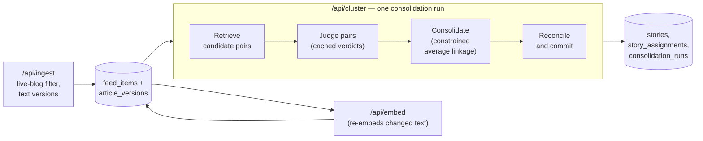
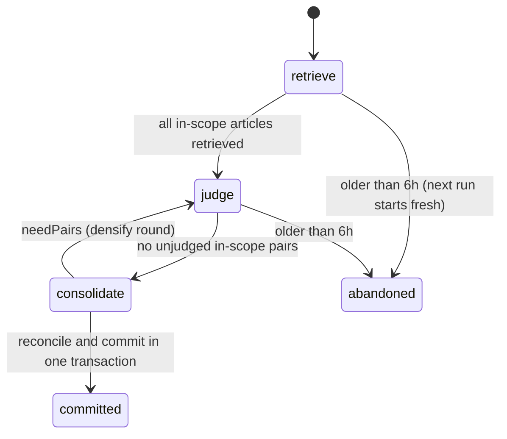

# Story Clustering v2 — TDD

| | |
|---|---|
| **Author** | Claude (Opus 5.5), with Camrick Solorio |
| **Created** | 2026-10-24 |
| **Updated** | 2026-10-24 |
| **Status** | Ready for review |
| **References** | PRD: [prd.md](prd.md) · Plan: [plan.md](plan.md) · Builds on and partly supersedes: [story-clustering-v1 TDD](../story-clustering-v1/tdd.md) (D18, D19, D33, D34 replaced) · Unblocks: [story-summary-v1](../story-summary-v1/tdd.md) · Research: [story-clustering-sota](../../research/story-clustering-sota.md) |

## TL;DR

Better News is meant to show one card per news event, with every outlet that covered it, so readers can compare their coverage. Today a big event often shows up as three to six small cards with one or two outlets each, because the system decides where each article goes one at a time, once, against a single candidate story, and never looks again. This feature changes that. Each run looks at the last few days of articles together and groups them by how strongly each pair of articles is judged to report the same event, so a story forms from all the evidence and no longer depends on the order articles arrived in. A single bad pairing can no longer block a correct one. Reactions, analysis and follow-ups stay as their own stories, exactly as in v1.

It also adds what the operator needs to trust and fix the result: a labelled set of real events with one command that reports how often events are split and how often stories are contaminated; a record of the exact text every decision was made on; and a logged, reversible repair that fixes stories already in the database.

### Requirements

The PRD's R1–R11 apply unchanged. Product decisions taken while writing this TDD (2026-10-24):

- **Live blogs are dropped at ingest.** They change headline and topic all day, so they never become stories.
- **Stories may keep changing after readers see them:** they can gain articles, absorb fragments, or lose an article that didn't belong. Readers get most of a story's value on first read, so this is acceptable.
- **A card nobody has seen must never disappear into a card people have already seen,** because readers would miss news. Concretely: (1) an article that has never been placed in any story may join any story, even an old one; (2) when two existing cards merge, the newer card survives and the older one is retired; (3) an article can always move out of a story into its own or another story.
- **Lateness limits:** two articles compared can be at most 36h apart, and a story spans at most 48h from its first to its last article.
- **The labelled event set is built by the owner** with an admin tool that proposes candidate articles for each event.

### Out of scope

- Fetching full article text (v1 D1 stands).
- Linking related stories into an evolving event.
- Reader-facing story cards and summaries ([story-summary-v1](../story-summary-v1/tdd.md)). This TDD only fixes the contract those cards rely on (how stories merge and which time they sort by).
- Reader accounts or per-reader read tracking.
- Cross-language clustering (all sources are English).

## Design

### Design overview

The design replaces v1's single-pass, greedy assignment with a **windowed consolidation**. Each run gathers the articles from the last 72 hours, plus any that have never been placed. Pairs of articles that are close in embedding space become candidate pairs. The classifier judges each candidate pair once and the verdict is cached against the exact text it saw. Stories are then rebuilt from the whole graph of verdicts by a constrained average-linkage clustering. A reconcile step maps the new groups onto existing story IDs, following the reader-safety rules above, and writes every membership change to the append-only log under a run ID, so any run can be reverted. The same machinery, pointed at an older date range, is the repair.



The design has nine parts, described here and specified in [Detailed design](#detailed-design) under the same names.

**1. Ingest guardrails.** Ingest drops live blogs. It also stops losing history: whenever a feed changes an article's title or description, the new text is saved as a new **article version** (a stored snapshot of title, description and publish time) instead of overwriting the only copy. The time used for clustering is fixed at the first publish time we saw, so a republish can't move an article around. This sits at ingest because that is the only point where the old text still exists. It closes PRD root cause 4 and is what R8 (auditable decisions) depends on.

**2. Re-embedding changed text.** The embed stage re-embeds an article whenever its current version is newer than the one its vector was built from. Nothing else in the stage changes. Without this, a retitled article would keep being clustered on its old meaning.

**3. Retrieve candidate pairs.** For every article whose embedding is new or has changed, a nearest-neighbour search finds articles within 36h whose similarity clears a floor, and records them as **candidate pairs** with their similarity. The candidates are fixed by a threshold rather than "the best story so far", so they don't depend on what was already clustered. That fixes root cause 1 (only one candidate was ever considered). Embeddings still only retrieve; they never decide a join (v1 D32).

**4. Judge pairs.** The classifier (jev, the v1 adjudicator, pinned to one version) judges each candidate pair with the v1 prompt and the v1 "same story" definition, unchanged. Verdicts are cached in a table keyed by both **article versions**, the model version and the prompt version. A pair is judged once, re-runs and sweeps are free, a text change triggers exactly the re-judgments it needs, and every verdict records the text it was based on. Human labels on a pair override the model.

**5. Consolidate.** The articles in scope and their judged pairs form a graph. Groups are merged bottom-up with **constrained average linkage**: two groups merge only when the *average* same-story probability across the pairs judged between them is high, enough pairs were judged, few of those pairs disagree, no human label forbids it, and the merged story stays within 48h. Before deciding a merge between larger groups, the step judges a few extra pairs against each group's anchors (its earliest article and its best-connected one), which keeps v1's guard against stories drifting away from their original event (v1 D34). Because the decision rests on an average over several pairs, one wrong member can't veto a correct join (R4, root cause 3), and the rule replaces the single τ cut-off that sat just above real same-event scores (root cause 2). Membership is computed from the whole graph with deterministic tie-breaks, so arrival order doesn't change the result (R7). Older stories outside the 72h window are frozen: they can still take in new articles, but their members don't move.

**6. Reconcile and commit.** The new groups are mapped onto existing stories using the three reader-safety rules. A group made only of never-placed articles becomes a new story. A group that overlaps existing stories keeps the ID of the **newest** of them, the others are retired with a pointer to it, and leftover members move to their own groups' stories. Everything is written in one transaction, and each article that moved gets a log row recording where it came from, where it went, the run, the version it was judged on, and the evidence. This step exists so that clustering can be recomputed freely while story IDs, the reader guarantee and the audit trail stay stable.

**7. Repair and revert.** A repair is a consolidation run over an explicit historical date range, logged like any other run. A revert replays a run's log in reverse. This fixes the three example events and then the rest of the labelled range (R9), with human labels and manual corrections respected as constraints. Repair needs no separate code path, so whatever the evaluation measured is what the repair does.

**8. Evaluation.** A labelled set of at least 30 real events, built by the owner in an admin tool, plus a new frozen snapshot that covers the examples. One command replays the snapshot through the same consolidation core and reports event recall, split counts, contamination, pairwise precision and related-leak together (R1, R3). It also reports spread across shuffled arrival orders (R7) and cost. A person-checked audit of random story memberships gives the precision number that carries the bar, as in v1. Tuning keeps a config only when recall improves without breaking precision.

**9. Operator tooling and orchestration.** `/api/cluster` keeps its v1 contract and lease, but each call now advances one consolidation run through its phases until it commits. The admin inspector shows, for any article, the versions it had, the text each decision was made on, the pairs judged and the runs that moved it (R8). The v1 "doesn't belong" action becomes a constraint the consolidation respects.

#### Design decisions

| # | Decision | Why | Rejected |
|---|---|---|---|
| V1 | Replace incremental single-pass assignment with windowed batch consolidation over the last 72h | Causes 1, 3 and order dependence (R7) are properties of deciding each article once, greedily, against one candidate. Re-deciding a rolling window from all evidence fixes all three, and on measured volume it costs about $0.20/day (see [Cost](#cost)). The PRD left this open; the measurements settle it | Patching the incremental path (top-N candidates, voting, a merge pass): each patch fixes one cause, and the result is still order-dependent and harder to reason about |
| V2 | Candidate pairs are every pair within 36h with similarity ≥ `T_low`, capped at 25 per article | A threshold-defined set doesn't depend on arrival order. The cap bounds cost on huge wire events | Top-k members of the best story (v1); top-k with a small k (order-dependent whenever it binds) |
| V3 | Average linkage over pairwise classifier verdicts, with constraints (minimum judged pairs, a dissent limit, human cannot-links, span ≤ 48h) | Averages over several pairs, so one wrong pair neither vetoes nor forces a join. Explainable: each merge has a recorded average and pair list. Less prone to chaining than single linkage or connected components | HDBSCAN or DBSCAN on embeddings (v1 measured that embeddings can't separate `same` from `related`); Leiden or Louvain community detection (needs edge-weight tuning, is harder to explain, and is non-deterministic unless seeded); connected components of `same` edges (chains A→B→C) |
| V4 | Anchor densification: before merging groups of 2 or more, judge pairs between their anchors (earliest article and best-connected member) | Keeps v1's drift guard (D34) without a single-member veto | Requiring `same` against the first article alone (v1 D34: one bad comparison blocks the join) |
| V5 | Keep pairwise jev verdicts and the v1 prompt and definition unchanged, but pin the jev version and recalibrate thresholds on events | jev's probabilities discriminate and the audited precision was 1.000 (lower bound 0.980). `jev-latest` silently moved from 1.13.0 to 1.14.0 on 2026-10-22, so the version must be fixed and part of the cache key | Story-level prompts with several headlines (cache keys break as stories change, and the probability is uncalibrated); switching models |
| V6 | Article versions: ingest saves a snapshot whenever title or description changes; verdicts are keyed by version; the clustering time is the first publish time seen | Required for R8, and it removes the overwritten-text failure mode (cause 4). A fixed time keeps the 36h and 48h limits stable when feeds republish | Storing the classifier's input text on each verdict only (duplicates text and doesn't fix re-embedding); keeping the latest `published_at` |
| V7 | Live blogs are filtered at ingest by per-source URL patterns; existing ones are marked excluded rather than deleted (2026-10-24, owner decision) | They change topic all day and caused the Alaska wrong join. Excluding rather than deleting keeps the decision log's foreign keys and history | Clustering them on their latest or first text (owner rejected) |
| V8 | Reader-safety reconcile rules: never-placed articles may join any story; when visible stories merge, the newest survives; articles may always move out (2026-10-24, owner decision) | With no reader accounts, the system can't know what someone has read. These rules guarantee that a card nobody has seen never vanishes into one they have, while allowing refinement | Older card survives (can hide a newer card); no merges between visible cards (fragments that already exist stay split) |
| V9 | 36h maximum gap between compared articles and 48h maximum story span, both swept in evaluation (2026-10-24, owner decision) | Covers the late arrivals in R6 (19h and 22h), and the classifier, not the window, is what keeps follow-ups out (R5). The span cap stops a long-running topic from chaining over days | v1's 12h from the first article (D33: caused cause 5); no cap |
| V10 | Stories older than the 72h active window are frozen: they can still take in never-placed articles but members don't move, and frozen stories never merge with each other | Bounds each run's work and stops old stories churning forever. A repair run can unfreeze a range on purpose | Unbounded re-clustering of all history |
| V11 | Repair is a consolidation run over an explicit date range, and revert replays a run's log in reverse | No second code path: what evaluation measured is exactly what repair does. Reversible by construction (R9) | A one-off merge script; hand edits in the admin tool |
| V12 | The labelled event set is built by the owner with candidate proposals from a permissive search, and events are sampled from permissive clusters rather than from the system's own stories (2026-10-24) | Sampling from the system's output would hide exactly the splits we're trying to measure. Human labels are the reference (as in v1) | Agent-drafted labels (the owner chose to label); taking events from current stories |
| V13 | No change to embeddings, embedding input, or the retrieval model; retrieval recall is measured on the event set first | In the traced Alaska case every fragment scored 0.91–0.95 against the main story, so retrieval found the right candidates; the misses were in the decisions. Changing the input (for example LLM-written event summaries, entity weighting) costs money and only helps if retrieval is the bottleneck | LLM event-summary embeddings (SOTA §4.3); NER entity-overlap penalty (SOTA §4.2). Both remain options if retrieval recall falls short |

v1 decisions superseded: D18 and D19 (window-fit candidates) by V2, V9 and V10; D33 (12h window) by V9; D34 (two-member veto) by V3 and V4. Everything else in v1 stands, notably D31 (definition), D32 (embeddings only retrieve), D35 and D37 (classifier choice by comparison, precision by audit).

### Detailed design

Platform as in v1: Next.js 16.3.6, React 19.2.8, TypeScript 5, `drizzle-orm` 0.45.x, Postgres 17.6 on Supabase with `pgvector` 0.8.2, Vercel Hobby (`maxDuration = 60`), `pnpm`. Classifier: TypeSafe jev through `llm.classify()` in [lib/llm.ts](../../../lib/llm.ts).

**Configuration** (`lib/pipeline/consolidate-config.ts`, all recorded in `pipeline_version`):

| Key | Starting value | Swept | Meaning |
|---|---|---|---|
| `tLow` | 0.84 | 0.80, 0.82, 0.84, 0.86 | Similarity floor for a candidate pair |
| `kMax` | 25 | 15, 25, 40 | Max candidate pairs retrieved per article |
| `maxGapHours` | 36 | 24, 36, 48 | Max time between two compared articles |
| `maxSpanHours` | 48 | 36, 48, 72 | Max first-to-last span of a story |
| `activeWindowHours` | 72 | none | Stories whose first article is older than this are frozen |
| `tauLink` | 0.80 | 0.60–0.93 in 0.05 steps | Minimum average `p_same` across judged cross pairs to merge |
| `minJudged` | 3 | 2, 3, 4 | Judged cross pairs required (or every pair, when fewer exist) |
| `dissentP` | 0.50 | none | A cross pair below this `p_same` counts as dissent |
| `maxDissent` | 0.25 | 0, 0.25, 0.34 | Max share of dissenting cross pairs |
| `densifyRounds` | 4 | none | Max rounds of anchor densification per run |
| `adjudicator.model` | `jev-1.14.0` (pinned; see Risks) | none | Classifier model and version |
| `adjudicator.promptVersion` | `v2` | none | v1 prompt, unchanged |
| `judgeConcurrency` | 8 | none | Parallel classifier calls |

#### 1. Ingest guardrails

**Live-blog filter** (`lib/live-blog.ts`, `isLiveBlog({ sourceId, link, title }): boolean`). These are per-source URL rules, checked against the 13 sources where live-blog-looking links appear (338 of 26,787 rows match a loose search on 2026-10-24). Generic patterns are avoided because they hit false positives such as PBS `live-map-…` and Washington Examiner `live-grenade-…`:

| Sources | Rule on the URL path |
|---|---|
| `guardian-*` | segment `/live/` |
| `nyt-*` | path starts `/live/` |
| `dw-*` | last segment matches `/live-\d+$/` |
| `aljazeera-*` | segment `/liveblog/` |
| `the-hill` | slug starts `\d+-live-updates-` |
| `cbs-*` | segment `/live-updates/` |
| `cnn-*` | segment `/live-news/` |
| `bloomberg-*` | segment `/live-blog/` |
| all sources | title starts `/^(live\|live updates)\s*[:\|–-]/i` |

The rules live in a table in the module, so a new source's pattern is a one-line addition. Ingest skips matching items before the upsert. If an existing row's link or title starts matching, ingest sets its `excluded_reason`. A one-off migration script marks existing matches `excluded_reason = 'live_blog'`. Excluded rows are never embedded, retrieved or clustered, and the repair (part 7) removes them from their stories.

**Article versions.** Ingest computes `content_hash = sha256(normalizeTitle(title) + "\n" + cleanSummary(summary))` (using [lib/text.ts](../../../lib/text.ts)) for every item. The upsert (`onConflictDoUpdate` in [app/api/ingest/route.ts](../../../app/api/ingest/route.ts)) now also sets `content_hash`, but never `first_published_at`. Then, in the same request:

```sql
INSERT INTO article_versions (article_id, title, summary, published_at, content_hash)
SELECT id, title, summary, published_at, content_hash FROM feed_items WHERE guid = ANY($guids)
ON CONFLICT (article_id, content_hash) DO NOTHING;

UPDATE feed_items f SET current_version_id = v.id
FROM article_versions v
WHERE v.article_id = f.id AND v.content_hash = f.content_hash
  AND f.guid = ANY($guids) AND f.current_version_id IS DISTINCT FROM v.id;
```

A change to `published_at` alone creates no version. For existing rows, the migration creates one version from the current text and sets `first_published_at = coalesce(published_at, created_at)`, which is the best we have. The **clustering time** of an article is `first_published_at`.

#### 2. Re-embedding changed text

[lib/pipeline/embed.ts](../../../lib/pipeline/embed.ts) selects rows where `excluded_reason IS NULL AND (embedding IS NULL OR embedding_version_id IS DISTINCT FROM current_version_id)`, and writes `embedding_version_id` along with the vector. The old vector stays in place until the new one lands, so the v1 constraint `clustered_at IS NULL OR embedding IS NOT NULL` keeps holding. The embedding model, input format and `embedding_input_version` are unchanged (V13).

#### 3. Retrieve candidate pairs

For each article in scope whose `pairs_version_id IS DISTINCT FROM embedding_version_id` (new or re-embedded):

```sql
SELECT set_config('hnsw.iterative_scan', 'relaxed_order', true);
SELECT f.id, 1 - (f.embedding <=> $e) AS cosine
FROM feed_items f
WHERE f.id <> $id AND f.excluded_reason IS NULL AND f.embedding_model = $model
  AND f.first_published_at BETWEEN $t - interval '36 hours' AND $t + interval '36 hours'
  AND 1 - (f.embedding <=> $e) >= $tLow
ORDER BY f.embedding <=> $e
LIMIT $kMax;
```

Results are upserted into `candidate_pairs (a_id, b_id)` in canonical order (`a_id < b_id`) with the cosine, replacing any earlier row for the pair, and the article's `pairs_version_id` is set. Pairs are symmetric, so an older article gains the new pair without being searched again. Measured on 2026-10-22 (1,209 articles, exact search over ±36h, k = 15): 5,932 unique pairs at 0.84 and 11,467 at 0.80, with 97% of articles having at least one pair at 0.80.

#### 4. Judge pairs

`lib/pipeline/judge.ts`. For every candidate pair whose two endpoints are in the run's scope (part 5) and which has no `pair_verdicts` row for `(version_a, version_b, model, promptVersion)`, it calls the existing `createAdjudicator(...).adjudicate(articleVersionA, articleVersionB)` from [lib/pipeline/adjudicate.ts](../../../lib/pipeline/adjudicate.ts). The article text it sends comes from `article_versions`, not `feed_items`. Calls run with `judgeConcurrency` parallelism until the deadline, and each result is inserted:

```
pair_verdicts
  version_a, version_b     uuid → article_versions.id   (canonical: version_a < version_b)
  article_a, article_b     uuid → feed_items.id          (denormalized for graph loads)
  model                    text   -- resolved version as returned, e.g. 'jev-1.14.0'
  prompt_version           text
  relation                 text   -- 'same' | 'related' | 'different' | 'invalid'
  p_same                   double precision
  cosine                   double precision
  llm_call_id              uuid → llm_calls.id
  created_at               timestamptz
  UNIQUE (version_a, version_b, model, prompt_version)
  INDEX (article_a), INDEX (article_b)
```

- **Edge weight** `w(a,b)`: a human label on the article pair (`eval_pair_labels`, `labeler = 'human'`) overrides the model. `same` gives w = 1. `related` or `different` makes the pair a **cannot-link**: the two articles can never be in one story. Otherwise w = `p_same`, and `invalid` counts as w = 0.
- **Failures:** a call that fails after retries leaves the pair unjudged; the run doesn't commit until the pair is judged or `remaining` reaches the budget (part 9). An open breaker or spent quota ends the call with `remaining > 0`, as in v1.
- **Version pin:** if the response's resolved model differs from `adjudicator.model`, the verdict is still stored under its real version, the run stops before commit, and the `adjudicator_version` health check fails. A model change means re-running the evaluation.

#### 5. Consolidate

`lib/pipeline/consolidate.ts` exports a pure function `consolidate(graph, cfg): { clusters, needPairs, trace }` with no I/O. Production and the replay harness share it.

**Scope.** In a scheduled run:

- **Active articles:** every non-excluded, embedded article with `first_published_at ≥ now − 72h`, plus every never-placed article (`placed_at IS NULL`) of any age.
- **Context:** the members of every story that has a judged pair with an active article.
- **Frozen clusters:** stories with `status = 'closed'`. Each is one fixed cluster: it may absorb active groups, but never loses members and never merges with another frozen cluster.
- **Pinned articles:** articles whose latest assignment is `manual`. They never move automatically; other articles may join their story.

In a repair run (part 7), every article in `[from, to]` is active and nothing in range is frozen.

**Graph.** Nodes carry `{ id, versionId, time, sourceId, storyId, placed, frozenStoryId?, pinnedStoryId? }`. Edges are the judged pairs between nodes, with `w`, the cannot-link flag and cosine. No embeddings are loaded.

**Algorithm.**

1. Initial clusters: one per frozen story, one per set of pinned articles sharing a story, and a singleton for each remaining active article.
2. For each pair of clusters (A, B) joined by at least one judged edge, compute `n` = number of judged cross pairs, `L` = mean `w` over them, and `dissent` = share of them with `w < dissentP`.
3. (A, B) is **eligible** when all of these hold: `L ≥ tauLink`; `n ≥ min(minJudged, |A|·|B|)`; `dissent ≤ maxDissent`; no cross pair is a cannot-link; the merged span is ≤ `maxSpanHours`; they aren't two frozen clusters or two clusters pinned to different stories; and anchor coverage holds (when |A| ≥ 2 or |B| ≥ 2, at least one judged cross pair touches each larger side's anchor).
4. **Anchors** of a cluster: its earliest article (by clustering time, then id) and its best-connected member (highest mean `w` to the rest of the cluster, then id).
5. If (A, B) would be eligible except for too few judged pairs or missing anchor coverage, and `L ≥ tauLink` on the pairs it has, add the missing anchor-to-anchor pairs (within `maxGapHours`) to `needPairs` and treat it as not eligible for now.
6. Merge the eligible pair with the highest `L`. Break ties by the smaller of the two clusters' lowest article ids, so the result never depends on row or arrival order. Recompute the affected linkages and repeat until nothing is eligible.
7. If `needPairs` isn't empty and fewer than `densifyRounds` rounds have run, the caller judges those pairs (part 4) and runs `consolidate` again **from scratch** on the larger graph. Re-running from scratch is what keeps the result a function of the graph alone.

`trace` records each merge (clusters, `L`, `n`, `dissent`, the pair ids used) for the decision log and the replay report. Complexity is about O(E log E) on a sparse graph of roughly 5k nodes and 25k edges per scheduled run, well under a second in Node.

#### 6. Reconcile and commit

`lib/pipeline/reconcile.ts` exports `reconcile(clusters, current): Changes` (pure), and `store-db.ts` applies the changes in one transaction.

1. Order clusters by size (descending), then by lowest article id.
2. For each cluster C, let `V(C)` be the existing stories that hold already-placed members of C.
   - If `V(C)` is empty: create a new story (rule 1: only never-placed articles).
   - Otherwise, the survivor is the story in `V(C)` with the latest `created_at` that no earlier cluster has taken (rule 2: the newest card survives). If all are taken, create a new story.
3. Any article whose story changes is moved (rule 3 covers moves out). Its log row has `from_story_id`, `story_id`, `method = 'consolidate'` (or `'repair'`), `run_id`, `article_version_id`, and `evidence` (the merge trace that put it there: `L`, `n`, `dissent`, pair ids). Articles that don't move get no row.
4. A story left with no members is set to `status = 'merged'`, `merged_into` = the survivor that took most of its members (ties to the newest).
5. Aggregates are recomputed for every touched story: `first_article_at`, `last_article_at`, `article_count`, `source_count`, the centroid (mean of member embeddings), and `window_ends_at = first_article_at + maxSpanHours`.
6. Never-placed articles get `placed_at = now()`.
7. **Freeze sweep:** open stories with `first_article_at < now − activeWindowHours` become `closed`.

**Sort contract for reader-facing cards** (for [story-summary-v1](../story-summary-v1/tdd.md) Phase 3): cards sort by `stories.created_at` descending, which is when the card first appeared. Under rule 2 a merge's survivor always has the latest `created_at` of the merged cards, so a merge never moves unseen content below content readers have seen. Summaries already derive staleness from membership (story-summary-v1 D7), so a membership change triggers a re-summary.

#### 7. Repair and revert

- **Repair:** `pnpm cluster:repair --from 2026-10-17 --to 2026-10-24 [--dry-run | --confirm]` runs parts 3–6 locally with `mode = 'repair'` over the range, under the same `cluster` lease as `/api/cluster`. `--dry-run` (the default) makes no classifier calls beyond cached ones and no writes. It prints the pairs it would judge, the cost estimate, and the planned changes per labelled event. `--confirm` judges and commits. Excluded live blogs in range are moved out of their stories with `method = 'exclude'` in the same run. Order: the three PRD example events first (a range of 2026-10-20 to 2026-10-24), then the rest of the snapshot range.
- **Revert:** `pnpm cluster:revert --run <id> [--confirm]` reads the run's `story_assignments` rows in reverse and moves each article back to `from_story_id`. Retired stories go back to their earlier status, and aggregates are recomputed. Everything is written as a new run with `mode = 'revert'` and `method = 'revert'` rows, and the original run gets `reverted_by`. Revert refuses if a later run moved any of the same articles, and lists those runs. Reverting inside the active window is pointless, because the next scheduled run recomputes it; change the config instead.
- **Human data:** human labels become cannot-links and `same` weights, and manual assignments become pins (part 5), so neither repair nor revert can override them. `eval_pair_labels` and manual rows are never written by either.

#### 8. Evaluation

**Snapshot.** `pnpm eval:snapshot --from 2026-10-17 --to 2026-10-24` writes `eval/snapshot-2026-10-24.jsonl` with articles, their current version and embeddings. It includes the three example events. The v1 snapshot (`snapshot-2026-10-05`) is kept for regression.

**Event labels (R1, V12).**

```
eval_events
  id uuid pk, title text, note text, split text  -- 'dev' | 'holdout'
  created_at timestamptz
eval_event_articles
  event_id → eval_events.id, article_id → feed_items.id,
  label text  -- 'in' | 'related' | 'out'
  labeler text, created_at timestamptz
  PRIMARY KEY (event_id, article_id)
```

- **Admin page** `/admin/events`, behind `ADMIN_SECRET`. The owner starts an event from one seed article. The page proposes candidate articles within ±48h of any `in` article with cosine ≥ 0.70 to any of them, most similar first, with source and time. The owner marks each candidate `in`, `related` (reactions, analysis, follow-ups) or `out`; each new `in` widens the candidates. The definition is pinned at the top, as in the labelling queue. Keyboard shortcuts: `i` / `r` / `o`.
- **Event selection:** the 3 PRD examples, plus 27 events sampled at random from the snapshot's permissive clusters (connected components of pairs with cosine ≥ 0.85 within 36h, which deliberately over-merge). The sample is stratified by size: 9 large (6 or more outlets), 9 mid (3–5), 9 small (2). Events with an even id hash are `dev` and the rest `holdout`; the three examples are `dev`.
- **Export:** `scripts/export-labels.ts` also writes `eval/events-YYYY-MM-DD.jsonl` keyed by article `guid`, and the import script restores it (v1 D26).
- **Derived pair labels:** within an event, `in`×`in` pairs count as `same` and `in`×`related` pairs as `related`. They feed the pairwise metrics alongside v1's 300 labelled pairs.

**Replay harness.** `pnpm eval:events --snapshot … [--config overrides] [--orders 5] [--confirm]` simulates the six-hour cron over the snapshot. Articles become visible at their ingest tick (`created_at` rounded to the 6h schedule). Each tick runs parts 3–6 with the in-memory store and cached verdicts. Without `--confirm` it spends nothing and prints the number of unjudged pairs and the cost. It reports:

| Metric | Definition | Bar |
|---|---|---|
| Event recall | Per event, the share of its `in` articles in the event's largest story (also reported per outlet); mean over events | ≥ 0.85 (R2) |
| Split | Per event, the number of stories holding its `in` articles; share of events with ≤ 2 | ≥ 80% (R2) |
| Contamination | Per event's main story, members labelled `related` (counted as leak) or `out`, plus unlabelled members (listed for review) | none for the 3 examples (acceptance criteria) |
| Pairwise precision / recall | On v1 labelled pairs plus derived event pairs; `related` counts as negative | precision ≥ 0.95 (R3 proxy) |
| Related-leak | Share of `related` pairs in one story | ≤ 10% (R3) |
| Order spread | Max − min of mean event recall over `--orders` runs that shuffle order within each tick and jitter each article's tick by up to ±1 | ≤ 0.03 (R7) |
| Retrieval recall | Share of `in`×`in` pairs that are candidate pairs | reported (V13) |
| Calls, cost | Classifier calls, cache hits, $ per day at the snapshot's volume | < $0.50/day with embeddings (R10) |

Results are reported separately for `dev` and `holdout` events.

**Tuning procedure.** First, measure v1 on the event set (replaying v1's `assignArticle` through the same harness) as the baseline. Then sweep the swept keys in the config table on `dev`. Keep the cheapest config that meets every bar on `dev`, then check it on `holdout`. R2 is met only if `holdout` mean event recall is within 0.05 of `dev` and the full set meets both bars.

**Membership audit (R3, v1 D37).** From the chosen config's replay, `pnpm eval:audit --mode membership` samples 150 random (member, anchor) pairs from multi-article stories, where the anchor is the story's earliest article and the member is any other article. They're labelled in `/admin/audit`. Precision is the share labelled `same`, with an exact 95% lower bound, and at most 2 errors in 150 are allowed for the bound to clear 0.95. This audits every membership, not only the joins the classifier made directly, which is stricter than v1.

**Summary golden set (R11).** `pnpm eval:events --golden` lists events whose main story after repair has event recall 1.0 and no contamination, for use as story-summary-v1 golden stories.

#### 9. Operator tooling and orchestration

**Data model changes** (one migration, `db:generate` + `db:migrate`, v1 D15):

```
feed_items (+)
  excluded_reason     text            -- 'live_blog' | null
  content_hash        text
  current_version_id  uuid → article_versions.id
  embedding_version_id uuid → article_versions.id
  pairs_version_id    uuid → article_versions.id
  first_published_at  timestamptz not null   -- clustering time; never updated after insert
  placed_at           timestamptz            -- first time placed in any story (reader-safety rule 1)
  INDEX (first_published_at) WHERE excluded_reason IS NULL

article_versions
  id uuid pk, article_id → feed_items.id, title text, summary text,
  published_at timestamptz, content_hash text, created_at timestamptz default now()
  UNIQUE (article_id, content_hash)

candidate_pairs
  a_id, b_id → feed_items.id   (a_id < b_id), cosine double precision, created_at
  PRIMARY KEY (a_id, b_id), INDEX (b_id)

pair_verdicts                  -- see part 4

stories (+)
  status        'open' | 'closed' | 'merged'
  merged_into   uuid → stories.id
  -- window_ends_at now = first_article_at + maxSpanHours

story_assignments (+)          -- still append-only
  method        + 'consolidate' | 'repair' | 'revert' | 'exclude'
  from_story_id uuid → stories.id
  run_id        uuid → consolidation_runs.id
  article_version_id uuid → article_versions.id
  evidence      jsonb

consolidation_runs
  id uuid pk, mode 'scheduled' | 'repair' | 'revert',
  scope_from, scope_to timestamptz, pipeline_version text,
  phase 'retrieve' | 'judge' | 'consolidate' | 'committed' | 'abandoned',
  started_at, committed_at timestamptz,
  stats jsonb  -- pairs retrieved/judged, merges, moves, new/retired stories, cost
  reverted_by uuid → consolidation_runs.id
```

Constraint changes: `stories.status IN ('open','closed','merged')`; `merged_into IS NOT NULL` exactly when `status = 'merged'`; the status trigger allows `open→closed`, `open→merged`, `closed→merged` (repair), and `merged→open/closed` only for revert runs; `pair_verdicts` and `candidate_pairs` require `a < b`.

**`/api/cluster`.** It keeps the v1 contract: `GET`, `Authorization: Bearer $CRON_SECRET`, the `cluster` lease, `{ processed, remaining, failed, durationMs }`, and `400`/`401`/`409`/`500`. Each call resumes the newest uncommitted `consolidation_runs` row, or starts one, and advances it through phases until the deadline:



`processed` counts pairs retrieved plus pairs judged this call, and `remaining` counts unretrieved articles plus unjudged pairs, plus 1 until commit. The workflow's loop (cap 50 iterations) is unchanged. A run left uncommitted for 6h is abandoned and the next starts fresh; cached verdicts carry over, so nothing is paid twice. `from`, `to` and `source` stay accepted for scoping. `mode=backfill` is now "repair over the range", and the local `cluster:repair` script is preferred for large ranges.

**Health checks (+).** `consolidation_commit`: the last committed scheduled run is under 12h old. `adjudicator_version`: no verdict in the last 24h has a model that differs from the configured one. The v1 checks stay; v1's "cluster freshness" now reads committed runs.

**Admin (R8).**

- `/admin/articles/[id]`: each version (title, description, publish time, first seen), which version the current vector and pairs came from, every candidate pair with its verdict per version (relation, `p_same`, model, prompt version) and the other article's story at the time of the run, and the assignment history (run, from and to story, evidence).
- `/admin/stories/[id]`: as in v1, plus for each member the version it was judged on and its linkage evidence, a "retired into" link for `merged` stories, and run links.
- "Doesn't belong" (v1): still writes human labels against the members it was linked through (now the cross pairs in its evidence), which become cannot-links, and a `manual` assignment, which pins the article. No other change.
- `/admin/runs`: recent consolidation runs with stats and a revert command hint.

**Code layout.** `lib/pipeline/retrieve.ts`, `judge.ts`, `consolidate.ts`, `reconcile.ts`, `run.ts` (phase driver), and the `store-db.ts` / `store-memory.ts` graph stores; `lib/live-blog.ts`; `scripts/cluster-repair.ts`, `scripts/cluster-revert.ts`, `scripts/eval-events.ts`. `assign.ts` is kept only for the v1 baseline replay.

## Risks

### Unknowns to investigate

| Unknown | What would settle it |
|---|---|
| Whether TypeSafe accepts a pinned version (`jev-1.14.0`) instead of `jev-latest` | Read their API docs and make one call (a fraction of a cent, with approval). If pinning isn't possible, key the cache on the resolved version and treat a version change as an evaluation trigger through the `adjudicator_version` health check |
| Whether jev 1.14.0 behaves like the audited 1.13.0 | Re-run the v1 reference comparison on 1.14.0 (about $0.03). The thresholds are recalibrated on events anyway |
| Retrieval recall at `T_low` 0.84 (V13) | The harness's retrieval-recall line. If many `in`×`in` pairs fall below the floor, sweep 0.80. If that is still short, consider event-summary embeddings as a follow-up |
| How often feeds change article text (version churn) | Count `article_versions` per day for a week after ingest ships. High churn means more re-judging (cheap) and more stories moving |
| jev throughput and rate limits at `judgeConcurrency` 8 | Measured p50 is 69–133ms per call with 0 failures in 18k calls, but no concurrency limit is published. Probe with the first repair `--dry-run` sizes, then increase concurrency until 429s appear |
| Whether `tauLink` around 0.80 holds precision once averaged | The membership audit. Observed Alaska same-event verdicts of 0.73–0.89 suggest averaging will clear them, but the bar is the audit, not this guess |
| How CNBC's "tariffs 'replaced'" article should be labelled | The owner decides while labelling (`in` or `related`). The design handles either |
| Live-blog rule coverage | After the migration, list excluded rows per source and spot-check 20, and search for `live` in titles of non-excluded rows. Add rules for misses |

### Technical risks

| Risk | Impact | Mitigation |
|---|---|---|
| **Average linkage chains** two events through a dense middle (for example a long-running trial, an evolving war story) | False merges, which hurt trust most | 48h span cap, the dissent limit, anchor coverage (V4), cannot-links from human labels, and the membership audit sampling every member against the story's earliest article |
| **Follow-ups slip in** at lower `tauLink` | R5 fails; related-leak rises | Related-leak and contamination are reported in the same report as recall (R1, R3). Tuning keeps a config only if both pass. The Starlink acceptance case is in `dev` |
| **Overfitting thresholds to 30 events** | Live precision or recall worse than measured | Dev/holdout split, the membership audit on random memberships, and production "doesn't belong" counts tracked over time |
| **Event set selection bias** | Metrics flatter the system | Events sampled from permissive, over-merging clusters rather than from current stories (V12), stratified by size |
| **Membership churn inside the 72h window** confuses the operator or re-triggers summaries often | Extra summary cost; stories that look unstable | Deterministic consolidation, so a story changes only when new evidence arrives. Story-summary-v1 re-summarizes on membership change; count moves per run in `consolidation_runs.stats` and alert if moves per run exceed 20% of active articles |
| **Rule 2 retires an older, larger story's ID** | Admin links and summary ids change on merges | Retired stories keep `merged_into`; the inspector follows it. Summaries are keyed by story and regenerated for the survivor |
| **Frozen-boundary effects:** an event straddling the 72h line can't merge its frozen part with an active fragment | A residual split for events that keep getting late fragments | Frozen clusters still absorb active groups; only frozen-with-frozen merges are blocked. Repair runs can unfreeze ranges deliberately |
| **A bad repair run** | Many stories damaged at once | `--dry-run` by default with per-event previews, the three examples first, revert by run, and human data never touched |
| **Ingest change corrupts `feed_items`**, the source of truth that can't be re-fetched | Data loss | Versions are insert-only. The migration only adds columns. Take a `feed_items` export before the migration, since the Supabase free plan has no backups (v1 risk) |
| **Cap of 25 pairs per article binds on huge wire events** | Some order dependence, and missing pairs in big stories | Big stories have many redundant pairs, so linkage still holds. Densification adds anchor pairs on demand. The order-spread metric shows whether it matters |
| **Live-blog false positives** drop real articles | Lost coverage | Per-source rules instead of generic ones; spot-check after the migration; exclusion is reversible (clear `excluded_reason`) |

### Scale, latency, and cost

Designed for the current ~1,000–1,250 articles/day across 31 feeds. Per scheduled run (every 6h), that means about 250–300 new articles to retrieve, a graph of roughly 4–5k nodes and 20–30k judged edges, and about 1–2k new classifier calls. At the measured p50 of ~100ms with concurrency 8, judging takes roughly 15–30s, and consolidation takes under a second in memory. The work fits in one or two 50s calls, and the 50-iteration loop leaves a large margin. Retrieval is about 10ms per article with HNSW iterative scans (v1 spike), so 3s per run.

Limits: the 60s function cap is handled by the phased, resumable run. The commit transaction touches at most a few hundred rows per scheduled run. Repair over a week (~7k articles, ~40k pairs) runs as a local script rather than on Vercel. Pair volume grows faster than article volume for big events but is bounded at `kMax` × articles. At 10× today's volume (~12k articles/day) cost would reach roughly $2/day and per-run judging several minutes; both would need revisiting (a lower `kMax`, a higher `T_low`, or a cheaper first-pass filter). That volume hasn't been evaluated.

## Open questions

None open. Answered 2026-10-24 by the owner:

- **Q1. How should live blogs be treated?** Dropped at ingest and never clustered (V7).
- **Q2. May stories change after readers see them?** Yes, they may keep being refined. The constraint is that unseen cards never disappear into seen ones, which gives the three reconcile rules, with "unseen" meaning never yet placed in any story (V8).
- **Q3. How far apart can same-event reports be?** 36h between compared articles and 48h story span, swept in evaluation (V9).
- **Q4. Who labels the event set?** The owner, with the tool-assisted admin page (V12).
- **Q5. Batch re-clustering or patching the incremental path?** Left open by the PRD, settled by measurement: batch consolidation (V1).

## Cost

Steady state at ~1,000–1,250 articles/day, using measured jev figures (≈650 input tokens per call, $0.042 per 1M input tokens, output free, so about $0.000027 per call):

| Item | Volume/day | Est. cost/day |
|---|---|---|
| Embeddings (`gemini-embedding-2`, unchanged plus re-embeds of changed text) | ~250–300k tokens | ~$0.02 |
| Pair judging at `T_low` 0.84 (new pairs plus ~20% densification and re-judges) | ~4–7k calls | ~$0.11–0.19 |
| Pair judging if tuning lands on `T_low` 0.80 | ~8–13k calls | ~$0.22–0.35 |
| **Total** | | **≈ $0.13–0.37/day**, under the $0.50 bar (R10) |

One-time costs. Each needs the owner's go-ahead before running (standing rule for paid classifier spend):

| Item | Est. cost |
|---|---|
| jev 1.14.0 pin probe and reference re-check | < $0.05 |
| Judging the 2026-10-17 to 10-24 snapshot for the replay at `T_low` 0.80 (a superset of every swept floor; cached for all later sweeps) | ~55–75k calls, ~$1.50–2.00 |
| Repair of the same range in production | Mostly cache hits from the replay, < $0.20 |
| v1 baseline replay on the new snapshot | Mostly cached, < $0.10 |

The replay's verdicts are written to `pair_verdicts` in the shared database, so the production repair reuses them.
