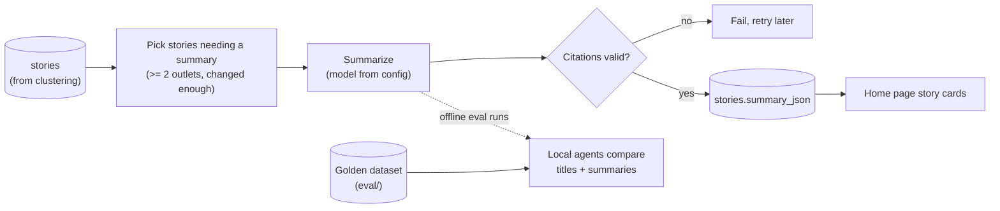

# Story Summary v1 — TDD

| | |
|---|---|
| **Author** | Claude (Sonnet 5.5), with Camrick Solorio |
| **Created** | 2026-10-03 |
| **Updated** | 2026-10-24 |
| **Status** | Ready for review |
| **References** | PRD: None (intent is captured in the TL;DR below) · Plan: [plan.md](plan.md) · Depends on: [story-clustering-v1](../story-clustering-v1/tdd.md) |

## TL;DR

Once articles are grouped into stories (see [story-clustering-v1](../story-clustering-v1/tdd.md)), this feature puts a short, neutral, source-cited AI summary on top of every story that has coverage from at least two outlets, and shows stories to readers as cards. A reader sees the gist of an event in a few bullet points, can check every claim against the articles it cites, and sees how outlets' framing differs. It is built after clustering, so grouping quality is known before any AI summarization is added.

### Requirements

- **R1.** A story with at least two distinct outlets gets a short, neutral summary as bullet points. Every bullet cites the articles it comes from.
- **R2.** The summary notes how specific outlets' framing or emphasis differs.
- **R3.** Summary quality is measurable, and the system meets these bars before it ships:
  - Zero unsupported claims on at least 95% of summaries.
  - Total running cost, including clustering, under $0.50/day.
- **R4.** The home page shows story cards (headline, summary, outlet chips, article count), with single-outlet articles shown alongside.
- **R5.** The operator can see each story's summary, its citations, and its quality scores in the admin tools.

### Out of scope

- Left/center/right lean labels. Outlets are compared by name.
- Fetching full article text. Summaries work from each article's title and RSS description.
- Any change to how stories are formed. That belongs to [story-clustering-v1](../story-clustering-v1/tdd.md).

## Design

### Design overview

A summarizer runs after clustering on the same six-hour schedule. It finds stories that need a (new) summary, sends the member articles' snippets to a language model, validates the structured, cited output in code, and stores it on the story. The home page reads the stored summaries directly. Quality is measured offline: local agents compare generated summaries to a small golden dataset (part 4), which is also how the summarizer model is chosen.



The design has five parts, described in order and specified in [Detailed design](#detailed-design) under the same names.

**1. Summarize.** Which stories get a summary, when one is regenerated, what the model sees, and what it must return. Summaries exist only for stories with at least two outlets because the point is comparing coverage, and they are regenerated only on meaningful change to keep cost and churn down. Output is structured bullet points and every bullet must cite, so unsupported text can be detected and rejected in code instead of trusted.

**2. Orchestration.** A new endpoint, `/api/summarize`, runs after `/api/cluster` as an idempotent, batched, resumable job, matching how clustering runs. This keeps the work inside a serverless function's time limit and safe to interrupt.

**3. Data model.** Summary columns on `stories` and a new `summary_evals` table for judge scores. Whether a summary is stale is derived from the story's current members, not a flag set during clustering, so clustering stays unaware of summaries.

**4. Evaluation.** Local agents (Claude or Gemini) compare generated titles and summaries to a small golden dataset and score faithfulness, coverage, and neutrality. A human spot check of the agents' verdicts calibrates them. The same harness compares candidate summarizer models.

**5. Admin and reader UI.** The admin stories inspector gains the summary, linked citations, and judge scores. The home page, a server component that reads straight from the database, shows story cards with singletons alongside.

#### Design decisions

| # | Decision | Why | Rejected |
|---|---|---|---|
| D1 | A summarized story needs ≥ 2 distinct outlets (2026-09-27) | The point is comparing outlets; a single-outlet "summary" adds nothing | Summarizing every story |
| D2 | No left/center/right lean labels (2026-09-27) | Out of scope; `coverage_notes` compares outlets by name instead | Lean labeling |
| D3 | Summaries use RSS title + description only (2026-09-27) | Keeps cost and complexity near zero; no scraping or paywall handling | Fetching full article text |
| D4 | Every bullet must cite; validation is done in code | Makes unsupported text detectable and rejectable instead of trusted | Trusting the model to cite |
| D5 | Re-summarize only when a new outlet joins or article count grows ≥ 30%; one final pass when the story closes, then freeze unless a late article joins it | Limits cost and summary churn | Re-summarizing on every join |
| D6 | Evaluation is done by local agents (Claude or Gemini) against a golden dataset, not a paid judge model (2026-10-24) | No API spend on evals, and the agents are in a different family from the OpenAI summarizers, so they don't share its blind spots. Replaces the earlier non-Gemini paid judge | An automated paid judge on every summary (deferred; revisit after the bake-off) |
| D7 | Staleness is derived from `summary_member_ids` versus current members (2026-10-03) | Clustering no longer sets a `summary_stale` flag, so clustering stays independent of summaries | A flag maintained during clustering |
| D8 | Summary columns are added by this feature's own migration (2026-10-03) | Clustering v1 ships and is measured first with a minimal schema | Adding them in clustering v1 |
| D9 | Reuse the shared LLM client and `llm_calls` from clustering v1 | One place for retries, caching, and cost accounting | A second client |
| D12 | Summarizer calls go directly to the provider (OpenAI), with no fallback provider or gateway (2026-10-24) | Simpler and cheaper to run; a failed call fails the run and is retried on the next batch | Routing through a gateway or falling back to another provider |
| D13 | The summary is bullet points: each bullet is one cited point (2026-10-24) | Matches the golden dataset's format and is easier to scan on a card | A prose paragraph |
| D10 | Summarizer model IDs live in config. The candidates are `gpt-4o-mini` and `gpt-6-luna` (2026-10-24) | Eval can A/B models without code changes. `gemini-3.8-flash` costs ~$0.98/day (doubling in 2027), which blows the $0.50/day bar; the two candidates are ~$0.13–0.18/day | Staying on `gemini-3.8-flash` |
| D11 | A small golden dataset of ~30–50 verified stories, with golden titles and summaries, drives evaluation (2026-10-24) | A fixed reference makes model and prompt changes comparable and cheap to re-run | Judging live summaries with no reference |

### Detailed design

Platform versions are as in [story-clustering-v1](../story-clustering-v1/tdd.md#detailed-design): Next.js 16.3.6, React 19.2.8, `drizzle-orm` 0.45.x, Postgres 17.6 on Supabase, Vercel Hobby, `pnpm`.

#### 1. Summarize

- **When a story is picked:** it has ≥ 2 distinct outlets (`source_count ≥ 2`) and either has no summary yet, or its current members differ from `summary_member_ids` by a new outlet or by article count grown ≥ 30%. When a story closes, one final pass runs if its members changed since the last summary, then the summary is frozen. A late or backfilled article that later joins a closed story (see [story-clustering-v1](../story-clustering-v1/tdd.md) D18) makes it stale again by the same rule, so it is re-summarized.
- **Model:** chosen by a bake-off between `gpt-4o-mini` and `gpt-6-luna` (D10), called directly through the shared client with the OpenAI key (D12, no fallback). Model IDs live in config. List prices, looked up 2026-10-24 and still to be confirmed on OpenAI's own pricing page: `gpt-4o-mini` $0.15 input / $0.60 output per 1M tokens; `gpt-6-luna` $0.10 / $0.50 (a reasoning model, so hidden reasoning tokens bill as output; the bake-off starts it at the lowest reasoning effort and measures real usage). Batch is 50% off for both. `gemini-3.8-flash` ($0.75 / $3.75, doubling 2027-01-01) is dropped on cost.
- **Input:** per article, `[n] Outlet — Title — cleaned snippet`, using the cleaned text from clustering's `lib/text.ts`.
- **Output** (structured JSON, schema-validated):

  ```json
  {
    "headline": "neutral, ≤ 90 chars",
    "summary": [{ "text": "one bullet point", "citations": [1, 3] }],
    "coverage_notes": [{ "text": "how outlets' framing or emphasis differs", "citations": [2] }]
  }
  ```

- **Validation:** every bullet must cite articles. Uncited bullets are dropped, and the whole summary fails if it cites a nonexistent article.
- **Prompt rules:** use only the provided text; no outside facts; attribute contested claims ("Fox reports…"); neutral headline; 3–5 short bullets, unpadded because inputs are snippets.
- **`coverage_notes`** compares specific outlets by name.

#### 2. Orchestration

- **Endpoint:** `/api/summarize`, authenticated like `/api/ingest` (`Authorization: Bearer $CRON_SECRET`).
- **Work selection:** stories matching the picking rules in part 1.
- **Contract:** each call caps its work to stay under the function time limit and returns `{ processed, remaining }`.
- **Workflow:** the existing GitHub Actions workflow calls it, after `/api/cluster`, in a loop until `remaining = 0`.
- **Code layout:** core logic in `lib/pipeline/*`, shared with local scripts.

#### 3. Data model

Added through a `db:generate` migration.

```
stories  (+ columns)
  headline            text
  summary_json        jsonb
  summary_model       text
  summarized_at       timestamptz
  summary_member_ids  uuid[]     -- membership at summary time
```

There is no `summary_evals` table for now: evaluation results are files under `eval/` (part 4). A table is added only if a production judge is adopted (see Open questions).

#### 4. Evaluation

- **Golden dataset:** ~30–50 verified stories (≥ 2 outlets, varied topics and outlet counts, some with thin snippets), written and chosen by the owner, with two golden fields per story: `title` and `summary` (bullet points). Stored as `eval/golden-summaries.jsonl`, one story per line: `id`, `title`, `summary` (bullets), and either inline `articles` or feed `guids` looked up in the database. `coverage_notes` has no golden counterpart, so it is not scored against the golden set.
- **Local-agent comparison** (`pnpm eval:summary`, in three steps: `generate` runs a model over the golden stories and costs money, so it needs `--confirm`; `pack` builds a packet with model names hidden and candidate order shuffled; `score` reads the agents' `verdicts-<agent>.json` files and prints per-model scores against the ship bar): for each golden story, local agents (Claude or Gemini) compare the generated title and summary bullets to the golden ones and check each bullet against its cited snippets. They score faithfulness, coverage, and neutrality (1–5) and list unsupported claims. Results are saved under `eval/`; no API judge cost.
- **Agent calibration:** the owner spot-checks ~10 of the agents' verdicts per rubric or prompt change; the rubric is tightened if they disagree on more than ~2.
- **Model bake-off:** the same golden set runs through `gpt-4o-mini` and `gpt-6-luna` with the same prompt. Compare the three scores, citation validity, summary length, and real cost per summary from `llm_calls`.
- **Ship bar:** zero unsupported claims on ≥ 95% of the golden stories.

#### 5. Admin and reader UI

- **Admin stories inspector** (extends the one from clustering v1): shows the summary with linked citations (and judge scores if a production judge is adopted). Gated by `ADMIN_SECRET` like the rest of `/admin`.
- **Home page** (`app/page.tsx`, a server component reading from the database): story cards with headline, summary, outlet chips, and article count, with singletons (articles not in a summarized story) alongside.

## Risks

### Unknowns to investigate

| Unknown | What would settle it |
|---|---|
| How many stories per day actually have ≥ 2 outlets | Count them from the first clustering runs; replaces the assumed ~130/day and drives summary and judge cost |
| Which of `gpt-4o-mini` and `gpt-6-luna` summarizes better, and at what real cost (including `gpt-6-luna`'s reasoning tokens) | The bake-off on the golden set (part 4) |
| Direct OpenAI model ID and price for `gpt-6-luna` | Look it up (the prices above are third-party list prices) and fill the config price table |
| Whether snippet-only inputs are enough for faithful, useful summaries | The agent scores and the owner's spot check on the golden set |
| Whether local agents are reliable enough as the evaluator | Compare the agents' verdicts to the owner's spot check |

### Technical risks

| Risk | Impact | Mitigation |
|---|---|---|
| **Thin or empty snippets** give the model little to summarize | Padded or unsupported bullets | Short output rules, mandatory citations, and validation in code; the agent evals on the golden set catch the rest |
| **Cluster errors flow into summaries** | A summary blends two different events | Clustering must meet its ship bar first; the inspector lets the operator correct a story |
| **Cost bar is tight even on cheap models.** Combined with clustering, the estimate (below) sits at about the $0.50/day bar. `gpt-6-luna` is a reasoning model whose hidden tokens could push cost above list-price math | Combined cost could exceed the bar | Lowest reasoning effort; batch pricing (50% off) since summarization is cron-driven; cut regenerations (D5 debounce); measure real usage in the bake-off before committing |
| **Agent evaluation is subjective and the golden set is small** | A model looks better or worse than it is | Human calibration of the agents; keep the rubric fixed across runs; treat ~30–50 stories as a screen, not proof; re-check on live summaries in Phase 2 |
| **API rate limits or outages.** There is no fallback provider (D12) | Throttled or failed calls fail the run | Backoff, small batches, and an idempotent resumable endpoint so the next batch retries; failures are logged in `llm_calls` |
| **Function time limit** on Vercel Hobby | A batch could be cut off mid-run | Batched, resumable, idempotent endpoint (part 2) |

### Scale, latency, and cost

Designed for roughly 130 summarized stories/day from ~1,000 articles/day. That story count is an assumption (the earlier 40-from-300 estimate scaled linearly); the real number of stories with ≥ 2 outlets is unknown until clustering runs. Summarization runs on the six-hour cron, so latency isn't user-facing; the home page reads stored summaries. Hard limits are the function time limit and free-tier request caps, handled as above. Volumes much beyond this haven't been evaluated.

Estimated steady-state cost at list prices (looked up 2026-10-24). Output sizes are estimates until real `llm_calls` data exists, and `gpt-6-luna`'s reasoning tokens are not included:

| Step | Volume/day | Est. cost/day |
|---|---|---|
| Summaries (`gpt-6-luna`, $0.10 / $0.50) | ~260 regens × ~3k input, ~400 output tokens | ~$0.13 (batch ~$0.07) |
| Summaries (`gpt-4o-mini`, $0.15 / $0.60) | same | ~$0.18 (batch ~$0.09) |
| Evaluation | offline runs on ~30–50 golden stories, local agents | ~$0 API cost; a few cents of summarizer calls per run |
| **Summary total** | | **≈ $0.13–0.18/day** (previously ≈ $1.10–1.45 on `gemini-3.8-flash`) |
| Clustering ([story-clustering-v1](../story-clustering-v1/tdd.md#scale-latency-and-cost)) | | ≈ $0.16–0.33/day |
| **Combined** | | **≈ $0.29–0.51/day** (at or just under the $0.50 bar; batch pricing leaves margin) |

## Open questions

1. **Is a production judge worth adding after the bake-off?** Offline golden-set evals don't catch regressions on live stories. Deferred; decide in Phase 2 once real cost and quality are known.

The summary decisions (D1–D3) were answered 2026-09-27.
